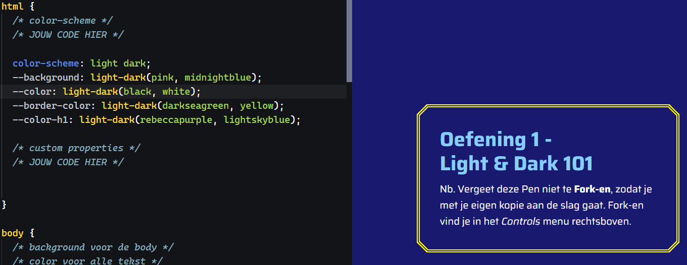
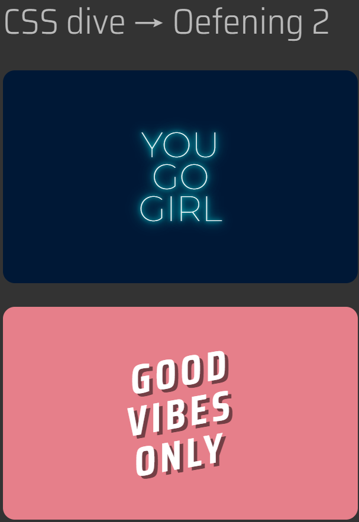
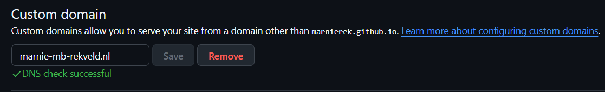

20 november (vrijdag); werkgroep

Thuis heb ik de mobile schermen geschets op basis van mijn crazy 8 en die heb ik daarbij heb ik er een gekozen om verder uit te werken en dus ook gelijk over de html na te denken. Met behulp van Sanne heb ik een duidelijk beeld erover en kon ik aan de slag in VSC.

Samen met Diederik heb ik het visuele aspect overlegt en mijn visie en inhoud duidelijk gemaakt. Ik ben van plan dit weekend alvast bezig te gaan met het designen van de achtergrond elementen en iconen.

Ik heb een aantal fonts gevonden die ik vind passen bij mijn thema en kleurpalet had ik tijdens de visuel research les woensdag al gevonden, een dark versie zijn dezelfde kleuren maar dan wat tinten donkerder.

---
18 november (woensdag); Workshop

Presenteren voor klasgenoten en de volgende vragen beantwoorden.
1. Wat is voor jou de essentie van wat je hebt gepresenteerd qua onderwerp en geschreven/beeldende content? ​Het gevoel dat de foto's overbrengen.

2. Heeft 'de ander' een aanvulling op je onderwerp?​ Bedenk alvast kopjes en wat voor werk je wilt laten zien als inhoud voor de website.

3. Wat is het karakter/ de uitstraling/ het gevoel dat bij het onderwerp past? (bijv. stoer, hip, vrolijk, dynamisch, eenvoudig, enz.)​ Mysterieus, elegant en natuurlijke uitstraling met een rustgevende en magische karakter.

4. Welke inspiratie kun je uit je 25 afbeeldingen halen. Stijl, een gevoel, vorm, enz. Scandinavische architectuur en eco-futuristisch met royaal detail.

5. Wat zou je willen vertellen over het onderwerp aan een ander? en hoe zou je dat voor je kunnen zien? middels welke beeld, tekst, animatie, inhoudelijke content? (bijv. Ik wil voornamelijk afbeeldingen tonen, als een soort Pinterest, of ik wil muziek fragmenten laten horen, of ik gebruik korte teksten met eigen foto's). ​Ik wil veel 'achtergrond elementen' laten bewegen zodat het er levendiger uit ziet. Ik wil experimenten met het uiterlijk van een knop.

Na het mirobord te vullen voor de visuel research ben ik toch een andere directie opgegaan. Namelijk Enchanted ruins/romantic decay het is zijn dan vooral oude gebouwen die leeg staan en natuur het heeft overgenomen.

Bespreek in duo's

1. Wat zijn de beste ideeën en waarom? ... en waarom de andere minder?
2. Zijn uitgangspunten terug te zien in de schetsen? Hoe is dat zichtbaar?
3. Is het idee online te vertalen? Hoe zouden vorm/ kleur of typografie in een schermontwerp kunnen worden getoond?
4. Is het idee expressief? Zit er genoeg uitdaging is? Ga je hiermee nieuwe CSS technieken leren? Zie je animaties of transities voor je?
5. Is het idee leuk en verrassend? Heb je zin om 'dit ontwerp' te maken?

Check-out:
1. Leg uit waar het Visual Research in 3 stappen naartoe werkt.

2. Vertel in 2 zinnen waar jouw Garden over gaat, en met welke content je dat gaat doen (beeld, tekst, sound, animatie enz).

3. Vertel kort welk idee van de Crazy 8 je het liefst zou willen uitvoeren/ verder zou willen onderzoeken.

Vul deze zin aan:
Ik wil mijn Digital Garden laten gaan over (eco-futurusism) Architectuur.
en wil dat laten zien door veel groen en patronen aan content te tonen.
Ik begin met een stukje eigen content over Wat is het, en wat vind ik er specifiek mooi aan. ​
Als het begin is gemaakt kan ik mijn Garden verder uitbreiden door het verder te uitwerken als mijn portfolio met een mooi jasje.

---
17 november (dinsdag); huiswerk

Ik ben vandaag aan de slag gegaan met de practica: Dark & Light.

Oefening 1:

Oefening 2:
https://codepen.io/editor/Marnie-Rekveld/pen/01a1ea59-2992-71d9-9b28-d683bfd7241b.

Oefening 3:
~~

En om morgen te kunnen presenteren heb ik een aantal foto's bij elkaar gehaald en in de presentatietemplate gedaan.

---
16 november (maandag); Sprint 1 

Na deze ReadMe goed te 'comitten' naar Github heb ik al mijn technische vragen destijds opgelost. 
Ik heb issues aangemaakt om alles overzichtelijk op een rijtje te zetten.

Daarna hebben wij ik groepjes van 9 een krantenartikel gelezen over Digital Gardens en aan andere groepjes een korte samenvatting verteld.

Tot slot hebben wij per klas verschillende Digital Gardens bekeken en onderzocht of ze wel 'webby' zijn of niet. Dit hielp ter inspiratie voor mijn eigen website en maakte duidelijk wat welke kanten je allemaal ermee op kunt.

Check-out:
1. Leg uit wat een digital garden is en waarom dat anders is dan een reguliere website.
Het is nooit af en kan maanden zonder update, ook hoef je niet aan standaard regels te houden zoals een social media format.

2. Leg uit wat een website 'webby' maakt en welke websites jou het meeste inspireren.
Hoe meer interacties en werkende knoppen(hovers, dark/light etc.). De website jen.dev (https://jen.dev/) spreekt mij het meest aan omdat het een game uiterlijk heeft, niet te veel uit of de box maar wel alles erin verwerkt en dus een goed navigerende website.
3. Vertel waar jij mee aan de slag wilt gaan bij het maken van jouw eigen digital garden (let op: dit zijn jouw eerste ideeën, dit kan en mag veranderen in de loop van het programma.) Wat ik ook zei bij de vorige vraag; een website met een UI van een game wat veel interactieve knoppen heeft.

---
13 november (vrijdag); Practica praktische CSS en CSS: fonts met kleur en effecten

Vasilis liet ons de opdrachten van het DLO maken terwijl hij rond liep voor vragen en na wat tijd was hij klasikaal bezig om het code te laten.
Er ging veel mis want je wordt gelijk het diepe in gegooit zonder voorkennis, veel waren ook spellingsfouten en codepen.io wou op een gegeven moment niks meer opslaan.

De 2e practica van Sanne ging wat soepeler en hoefte maar een paar aanpassingen te doen aan het werk dat ik al zelf thuis had gedaan.

De 2e oefening was het namaken van motivational quotes.

---
12 november (donderdag); huiswerk

Ter voorbereiding voor de practia lessen vrijdag heb een ingelogd in mijn codepen.io account en een lege pagina aangemaakt met de volgende eisen:

En geprobeerde de eerste oefening van de 2e les te maken maar het werkte maar niet.

---
11 november (woensdag); Practica interactie: MMD, micro-interacties, forms en Schetsen van o.a. interactie en animatie

Nicky heeft de presentatie gegeven over interactie, veel wist ik al en het was meer een refresher. Als opdracht werd gegeven om een menuscherm uit te werken voor een thai's wokreastaurant, dat heb ik eerst als schets gemaakt en daarna in Figma uitgewerkt.

Charley gaf ook haar presentatie en gaf meerdere korte teken opdrachten om makkelijker en beter een wireframe te maken. Als toevoeging tot de opdracht van Nicky moesten wij nadenken en schetsen welke animaties er in ons ontworpen scherm kan komen.

---
9 november (maandag); Kick-off

Wij zijn vooral bezig geweest met het maken van de domeinnaam en het installeren van de benodigde applicaties, en vooral wachten tot dat TransIP mijn domein de wereld in stuurd. Wat uiteindelijk nog is gelukt voordat de les voorbij is. Ook heb ik de website kunnen openen in VSCode en opgeslagen op mijn laptop zodat ik kan beginnen met code schrijven.

Check-out:
1. Leg uit wat een source hosting platform is en voor welke jij gekozen hebt.
Een source hosting platform is een platform dat de website 'hoste' zodat jij gemakkelijker een website kan ontwerpen, ik gebruik Github.
2. Vertel welke domeinnaam jij gekozen hebt en hoe je die hebt gekoppeld aan jouw pagina.
Ik heb mijn eigen naam gebruikt; Marnie-MB-Rekveld.nl om het eventueel later de gaan gebruiken voor mijn portfolio. Dit heb ik gedaan via TransIP, ik heb de domeinnaam geclaimt en gekocht en gekoppeld aan GitHub en Visual Studio Code.

3. Beschrijf hoe je aanpassingen aan jouw pagina kunt maken en hoe je er voor zorgt dat die op het web gepubliceerd worden.
Met behulp van Visual Studio Code ga ik mijn website ontwerpen, als ik heb na wat aanpassingen online zet kan ik zien hoe de code zich vertaald naar visuele elementen.
