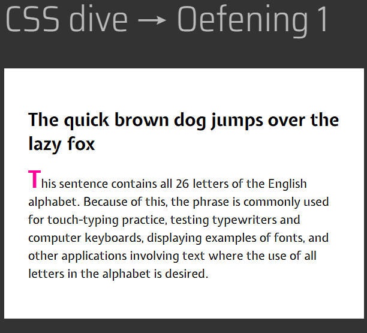
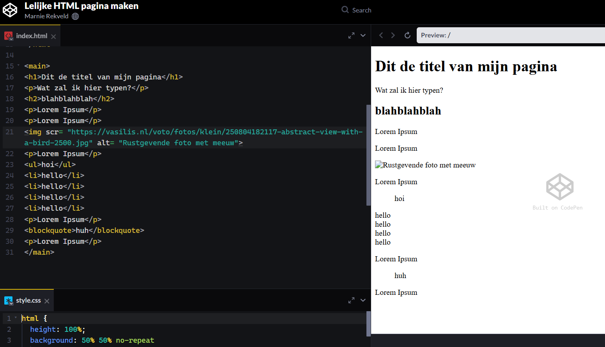
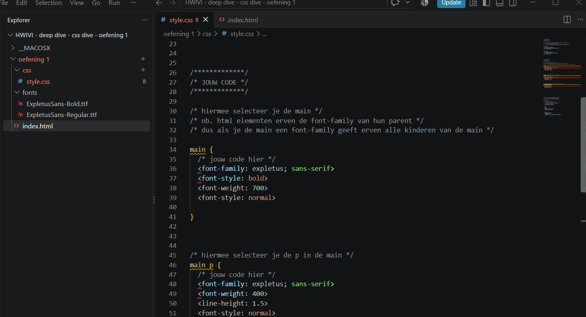

11 november (woensdag); Practica interactie: MMD, micro-interacties, forms

Nicky heeft de presentatie gegeven over interactie, veel wist ik al en het was meer een refresher.

Charley gaf ook haar presentatie en gaf meerdere korte teken opdrachten om makkelijker en beter een wireframe te maken.

13 november (vrijdag); Practica praktische CSS en CSS: fonts met kleur en effecten

Vasilis liet ons de opdrachten van het DLO maken terwijl hij rond liep voor vragen en na wat tijd was hij klasikaal bezig om het code te laten.
Er ging veel mis want je wordt gelijk het diepe in gegooit zonder voorkennis, veel waren ook spellingsfouten en codepen.io wou op een gegeven moment niks meer opslaan.

De 2e practica van Sanne ging wat soepeler en hoefte maar een paar aanpassingen te doen aan het werk dat ik al zelf thuis had gedaan.

De 2e oefening was het namaken van motivational quotes.

12 november (donderdag); huiswerk
Ter voorbereiding voor de practia lessen vrijdag heb een ingelogd in mijn codepen.io account en een lege pagina aangemaakt met de volgende eisen:

En geprobeerde de eerste oefening van de 2e les te maken maar het werkte maar niet.

11 november (woensdag); Practica interactie: MMD, micro-interacties, forms en Schetsen van o.a. interactie en animatie

Nicky heeft de presentatie gegeven over interactie, veel wist ik al en het was meer een refresher. Als opdracht werd gegeven om een menuscherm uit te werken voor een thai's wokreastaurant, dat heb ik eerst als schets gemaakt en daarna in Figma uitgewerkt.

Charley gaf ook haar presentatie en gaf meerdere korte teken opdrachten om makkelijker en beter een wireframe te maken. Als toevoeging tot de opdracht van Nicky moesten wij nadenken en schetsen welke animaties er in ons ontworpen scherm kan komen.

9 november (maandag); Kick-off

Wij zijn vooral bezig geweest met het maken van de domeinnaam en het installeren van de benodigde applicaties, en vooral wachten tot dat TransIP mijn domein de wereld in stuurd. Wat uiteindelijk nog is gelukt voordat de les voorbij is. Ook heb ik de website kunnen openen in VSCode en opgeslagen op mijn laptop zodat ik kan beginnen met code schrijven.

Vragen van vandaag:

1. Leg uit wat een source hosting platform is en voor welke jij gekozen hebt.
Een source hosting platform is een platform dat de website 'hoste' zodat jij gemakkelijker een website kan ontwerpen, ik gebruik Github.
2. Vertel welke domeinnaam jij gekozen hebt en hoe je die hebt gekoppeld aan jouw pagina.
Ik heb mijn eigen naam gebruikt; Marnie-MB-Rekveld.nl om het eventueel later de gaan gebruiken voor mijn portfolio. Dit heb ik gedaan via TransIP, ik heb de domeinnaam geclaimt en gekocht en gekoppeld aan GitHub en Visual Studio Code.

3. Beschrijf hoe je aanpassingen aan jouw pagina kunt maken en hoe je er voor zorgt dat die op het web gepubliceerd worden.
Met behulp van Visual Studio Code ga ik mijn website ontwerpen, als ik heb na wat aanpassingen online zet kan ik zien hoe de code zich vertaald naar visuele elementen.
